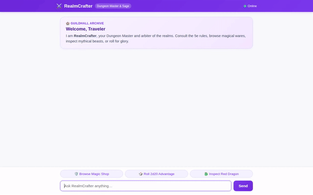

# RealmCrafter - Fantasy RPG Character & Quest Companion



**RealmCrafter** is an autonomous, multimodal tabletop RPG assistant and game-master sage built with the **Google Agent Development Kit (ADK)** and deployed on **Google Cloud Agent Platform**. It empowers tabletop adventurers and Dungeon Masters to inspect monster rules, manage gear, roll dice with advantage/disadvantage, generate concept art and cinematic videos, execute battle math in a secure Python sandbox, and preserve campaign lore across sessions.

---

## 🌟 Implemented Features & Google Cloud Services

The capabilities below reflect the exact tools and services wired into the codebase (`app/` and `agents-cli-manifest.yaml`):

### 1. 🧠 Cross-Session Long-Term Memory (Vertex AI Memory Bank)
* **Preload Memory**: Uses `PreloadMemoryTool` to inject past session memories (character profiles, party stats, campaign decisions) directly into the agent's turn context.
* **Automatic Session Archival**: An `after_agent_callback` (`generate_memories_callback`) persists new facts and updates to Vertex AI Memory Bank (`VertexAiMemoryBankService`).
* **Custom Memory Topics**: Configured with a dedicated `user_allergies` memory topic to track user dietary restrictions and ingredient allergies across sessions, ensuring the sage never recommends conflicting tavern meals or herbal potions.

### 2. 🗄️ Equipment & Magic Item Catalog (Google Cloud Firestore)
* **Database Backend**: Integrated with Google Cloud Firestore (`items` collection) to manage RPG equipment (`app/firestore_tools.py`):
  * `get_item`: Looks up weapon, armor, potion, or wondrous item details by name or document ID.
  * `list_items`: Browses the catalog filtered by category (`weapon`, `armor`, `potion`) or rarity (`common`, `rare`, `legendary`).
  * `add_item`: Forges homebrew or customized items directly into Firestore.

### 3. 🎨 Multimodal Concept Art Generation (Gemini Image Model & Cloud Storage)
* **Model**: Generates high-resolution fantasy item and creature illustrations using `gemini-3.1-flash-lite-image` (`app/image_tools.py`).
* **Session Artifacts**: Saves the generated PNG/JPEG bytes to session storage via `tool_context.save_artifact` for display in the ADK developer UI.
* **Public Asset Hosting**: Uploads the image bytes directly to a public Google Cloud Storage bucket (`realmcrafter-assets-...`) and returns the public HTTPS URL.

### 4. 🎬 Cinematic Video Generation (Google Omni Model & Cloud Storage)
* **Omni Model**: Generates cinematic video clips for magical items and encounters using Google's `gemini-omni-flash-preview` model via the Vertex AI Interactions API in the global region (`app/video_tools.py`).
* **Artifact & Storage Delivery**: Saves MP4 bytes to session artifacts and streams them directly to Google Cloud Storage under `videos/` without writing intermediate local files.

### 5. 💻 Cloud Sandbox Code Execution (Vertex AI Reasoning Engine Sandbox)
* **Secure Sandbox**: Configured with `AgentEngineSandboxCodeExecutor` hosted on Vertex AI Agent Platform.
* **Python Simulation**: Executes real-time Python scripts inside the cloud sandbox to calculate factorial damage, compute dice probability distributions, and evaluate complex combat algorithms.

### 6. 🗺️ Real-World Gaming Venue Discovery (Google Maps Platform)
* **Geocoding & Places (New)**: Integrated via `app/maps_tools.py`:
  * `geocode_address`: Converts cities, neighborhoods, or addresses into latitude/longitude coordinates via Google Maps Geocoding API.
  * `find_nearby_places`: Searches for nearby tabletop hobby shops, board game cafes, and gaming venues using Google Maps Places API (New).

### 7. 📜 D&D 5e Rules, Dice Roller & Combat Tools
* **Live SRD Rules**: Fetches spell details (`fetch_srd_spell`) and monster stat blocks (`fetch_srd_monster_stats`) via open SRD APIs (`app/tools.py`).
* **Dice Roller (`roll_dice`)**: Parses standard dice notation (`XdY+Z`), with support for advantage, disadvantage, and bonus modifiers.
* **Character Sheet Manager (`update_character_sheet`)**: Tracks character stats, class, level, hit points, gold, and inventory.
* **Combat Simulator (`simulate_combat_round`)**: Simulates attack rolls against Target AC, damage rolls, and hit point resolution.

### 8. 🖼️ Rich A2UI Interface (Agent to UI)
* **Callback Formatting**: Uses `a2ui_callback` (`app/a2ui_utils.py`) to intercept structured output from Gemini and render interactive A2UI surfaces (`Card`, `Column`, `Row`, `Text`, `Image`).
* **Custom Display Surfaces**: Emits tailored cards for dice roll results, monster stat blocks, magic item inspect cards, and character overviews.

### 9. 💬 Custom RPG Dialogue Chat Frontend
* **FastAPI A2A Proxy**: Located in `frontend/main.py`, bridges web browser clients to the deployed Agent Runtime using the Agent-to-Agent (A2A) protocol.
* **Immersive Theme**: Located in `frontend/static/index.html`, features an arcane violet palette, guildhall welcome card, distinct Adventurer/Sage avatar badges, quick-action prompt chips, and a client-side A2UI renderer.

---

## 📋 Status of Planned Capabilities

| Capability | Status | Implementation Details |
| :--- | :--- | :--- |
| **Character Profile & Memory** | ✅ Implemented | Vertex AI Memory Bank + `update_character_sheet` |
| **Dice Rolling (`roll_dice`)** | ✅ Implemented | Standard notation with advantage / disadvantage |
| **SRD Monster & Spell Lookup** | ✅ Implemented | `fetch_srd_monster_stats`, `fetch_srd_spell` |
| **Firestore Equipment Catalog** | ✅ Implemented | `get_item`, `list_items`, `add_item` |
| **Image Generation** | ✅ Implemented | `gemini-3.1-flash-lite-image` + Cloud Storage |
| **Video Generation** | ✅ Implemented | `gemini-omni-flash-preview` + Cloud Storage |
| **Sandbox Code Execution** | ✅ Implemented | `AgentEngineSandboxCodeExecutor` on Vertex AI |
| **Maps Hobby Shop Search** | ✅ Implemented | Geocoding & Places API (New) |
| **A2UI Cards & Displays** | ✅ Implemented | Dice, monster, item, and character cards |
| **Custom Dialogue Frontend** | ✅ Implemented | FastAPI A2A proxy + themed HTML/CSS/JS |
| **Interactive Quest Board Table UI** | ⏳ *Planned, not yet implemented* | Multi-row table component for quest tracking |

---

## 📁 Repository Structure

```
realmcrafter/
├── app/
│   ├── agent.py               # Root ADK agent, system instructions, tools, and sandbox executor
│   ├── a2ui_utils.py          # A2UI card formatting and callback handler
│   ├── fast_api_app.py        # FastAPI server with A2A protocol and Reasoning Engine routes
│   ├── firestore_tools.py     # Firestore catalog tools (get_item, list_items, add_item)
│   ├── image_tools.py         # Gemini image generation and Cloud Storage upload
│   ├── video_tools.py         # Google Omni video generation and Cloud Storage upload
│   ├── maps_tools.py          # Google Maps Geocoding & Places API integration
│   ├── tools.py               # SRD rules lookup, dice roller, combat simulator, character sheets
│   └── app_utils/             # Memory service builders and Reasoning Engine adapters
├── frontend/
│   ├── main.py                # FastAPI proxy connecting browser to deployed agent over A2A
│   ├── Dockerfile             # Container definition for frontend deployment
│   ├── requirements.txt       # Frontend Python dependencies
│   └── static/
│       └── index.html         # RPG dialogue UI, avatars, prompt chips, and A2UI renderer
├── tests/
│   └── unit/                  # Comprehensive pytest test suites
├── agents-cli-manifest.yaml   # Agent manifest configuration
├── pyproject.toml             # uv dependencies and project metadata
├── realmcrafter_demo.gif      # Looping screencast demo
└── README.md
```

---

## 🚀 Setup & Local Execution

### 1. Prerequisites
* Python 3.12+
* [uv](https://docs.astral.sh/uv/) package manager
* Google Cloud SDK (`gcloud`) authenticated with a project having Vertex AI, Firestore, and Cloud Storage APIs enabled.

### 2. Environment Configuration
Create a `.env` file in the project root:
```bash
GOOGLE_CLOUD_PROJECT=<YOUR_PROJECT_ID>
GOOGLE_CLOUD_LOCATION=us-central1
GOOGLE_MAPS_API_KEY=<YOUR_GOOGLE_MAPS_API_KEY>
```

### 3. Install Dependencies
```bash
uv sync
```

### 4. Run the ADK Web Playground
To run the local ADK developer interface with Memory Bank support:
```bash
uv run adk web . --port 8080 --reload_agents --memory_service_uri=agentengine://<YOUR_AGENT_ENGINE_ID>
```
Access the interface in your browser at the local port specified (e.g. port 8080).

### 5. Run the Custom RPG Dialogue Frontend
To run the custom chat frontend locally against your deployed agent:
```bash
cd frontend
python -m venv .venv
source .venv/bin/activate
pip install -r requirements.txt

export AGENT_ENGINE_RESOURCE_NAME="projects/<PROJECT_NUMBER>/locations/us-central1/reasoningEngines/<ENGINE_ID>"
export AGENT_DIRECTORY="app"
export PORT=8080

python main.py
```
Access the chat UI in your browser at the local port specified (e.g. port 8080).

---

## 🧪 Running Automated Tests

Run the test suite using `pytest`:
```bash
uv run pytest tests/unit -v
```
